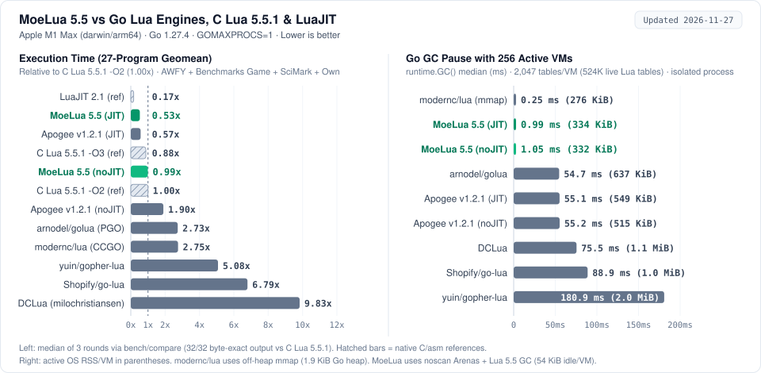
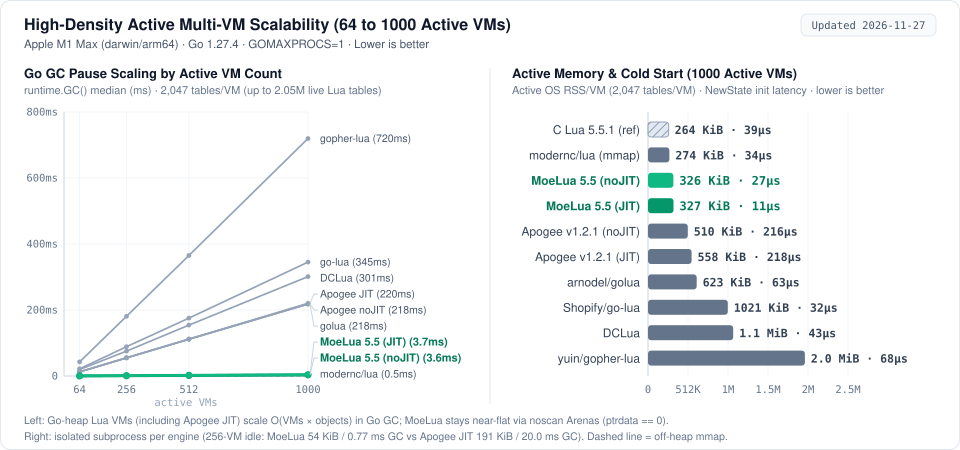

# MoeLua

A high-performance Go implementation of Lua 5.5 featuring a Plan 9 direct-threaded interpreter, an optional native ARM64/AMD64 JIT, per-`State` noscan Arenas with a true Lua 5.5.1 GC, and a standalone CLI.

## Performance

Across the 27-program standardized cross-engine suite (`Are We Fast Yet`, `Benchmarks Game`, `SciMark 2.0a`, and Go engines' own benchmarks) on Apple M1 Max (`darwin/arm64`, Go 1.27.4, `GOMAXPROCS=1`):

- **`MoeLua 5.5 (JIT)`** achieves a **`0.53×`** geometric mean relative to C Lua 5.5.1 `-O2` (**1.90× faster** than C `-O2`, **1.66× faster** than C `-O3`, and the fastest Go Lua engine overall, including **3.85×** faster than C `-O2` on `SciMark 2.0a` and **20.0×** on `scimark/LU` via NEON/SSE2 auto-vectorization).
- **`MoeLua 5.5 (noJIT)`** achieves **`0.99×`** relative to C Lua 5.5.1 `-O2` — beating native C Lua 5.5.1 `-O2` without a JIT, and running **1.92×–9.9×** faster than other Go Lua interpreters.



### High-Density Multi-VM Scalability

Most Go Lua engines (including JIT-compiled ones) store Lua tables and values as pointer-rich Go heap objects, so Go's garbage collector must scan every live Lua object across every tenant VM — causing **O(VMs × objects)** GC pauses that grow past **218–720 ms** at **1,000 active VMs (>2M live tables)**.

MoeLua keeps all Lua values (`ptrdata == 0`), tables, shapes, strings, and stacks in per-`State` noscan `[]byte` Arenas with a true PUC-Rio Lua 5.5.1 GC, and shares reference-counted Tier-1 JIT machine code across concurrent `State`s:

- **`MoeLua 5.5 (noJIT)`**: **3.57 ms** Go GC at 1,000 active VMs, **54 KiB** idle RSS, **326 KiB** active RSS/VM.
- **`MoeLua 5.5 (JIT)`**: **3.75 ms** Go GC at 1,000 active VMs (**59×–192×** lower than Go-heap Lua VMs), **54 KiB** idle RSS, **327 KiB** active RSS/VM (**1.71×** smaller than `Apogee JIT`'s 558 KiB), and **~11–27 µs** cold `NewState`.



Both charts above are automatically regenerated on every merge to `main` by GitHub Actions ([`bench-compare.yml`](.github/workflows/bench-compare.yml)) using the standalone [`bench/compare`](bench/compare) nested module, where every engine runs identical Lua 5.1-compatible source and is verified byte-for-byte against C Lua 5.5.1. Full per-program tables, `LuaJIT` baselines, Peak RSS, embedding microbenchmarks (`NewState` 4.8 µs, `Call1` 39 ns / 0 allocs, `RegisterFunc1` ~30 ns / 0 allocs), and Apple M1 Max reference numbers are in [`docs/benchmarks.md`](docs/benchmarks.md).

## Why MoeLua

- **Zero CGo, zero dependencies, opt-in native JIT**: builds with `CGO_ENABLED=0` and zero third-party dependencies, cross-compiles cleanly to Linux, macOS, and Windows, works with `pprof` and `-race`, and avoids CGo thread pinning. Runs a Plan 9 direct-threaded bytecode interpreter by default (`MoeLua 5.5 (noJIT)`); opt into the native ARM64/AMD64 baseline + typed-SSA/SIMD JIT (`MoeLua 5.5 (JIT)`) per `State` via `moelua.WithJIT()` or CLI `-jit`, with automatic graceful fallback to the interpreter on unsupported platforms or restricted `PROT_EXEC` environments. Build with `-tags moeluanojit` to exclude the JIT backend, or `-tags "purego moeluanojit"` for a 100% pure-Go build with zero assembly.
- **Noscan Arena, true Lua 5.5.1 GC, and shared JIT code cache**: all Lua values (16-byte tagged `Value`, `ptrdata == 0`), tables, shapes, inline caches, strings, closures, upvalues, threads, and frames live in per-`State` noscan `[]byte` slabs managed by a PUC-Rio Lua 5.5.1 incremental + generational GC (`__gc`, weak tables, ephemerons, resurrection). Shared Tier-1 native code regions are reference-counted across independent `State`s, so Go's GC performs zero pointer scanning inside Lua heaps and enabling JIT adds ~1 KiB/VM at 1,000 active VMs.
- **Exact Lua 5.5.1 compatibility**: passes the official PUC-Rio Lua 5.5.1 conformance suite (`testes/`, `main.lua`, and byte-for-byte `luac 5.5.1` binary chunk identity), supporting `global`, `<const>`, `<close>`, named/hidden varargs, stackful yieldable coroutines (across metamethods, `pcall`/`xpcall`, iterators, and `<close>`), and the full standard library (`base`, `math`, `table`, `string`, `utf8`, `coroutine`, `debug`, `io`, `os`, `package`).
- **Built for safe host embedding**: cooperative `context.Context` cancellation and deterministic instruction budgets (uncatchable by Lua `pcall`/`xpcall`, zero overhead on the hot loop when unset, enforced at native JIT poll safepoints), per-`State` memory limits, `io/fs.FS` / `embed.FS` module loading, zero-allocation `Call1` / `RegisterFunc1`, and immutable `*moelua.Chunk` sharing across independent goroutines.

## Installation

### Standalone CLI

```sh
go install github.com/yuchanns/moelua/cmd/moelua@latest
moelua -e 'print(_VERSION, 6 * 7)'
moelua -jit script.lua
```

Supports `-jit`, `-e`, `-l`, `-i`, `-v`, `-W`, `-E`, `--`, `-`, `LUA_INIT_5_5`, `LUA_PATH_5_5`, interactive REPL, and `SIGINT` handling.

### Go Library

```sh
go get github.com/yuchanns/moelua
```

Requires Go 1.27 or later. Each `*moelua.State` is single-goroutine and lock-free; compile once with `moelua.Compile` and load the immutable `*moelua.Chunk` into independent states across goroutines.

```go
package main

import (
	"context"
	"embed"
	"fmt"
	"time"

	"github.com/yuchanns/moelua"
)

//go:embed scripts/*.lua
var scriptsFS embed.FS

func main() {
	ctx, cancel := context.WithTimeout(context.Background(), 2*time.Second)
	defer cancel()

	s := moelua.New(
		moelua.WithJIT(), // optional native JIT on arm64/amd64; falls back cleanly
		moelua.WithContext(ctx),
		moelua.WithMemoryLimit(32<<20),
		moelua.WithInstructionLimit(1_000_000),
		moelua.WithFS(scriptsFS),
	)
	defer s.Close()

	// Zero-allocation single-return Go callback:
	s.RegisterFunc1("add", func(s *moelua.State, args []moelua.Value) (moelua.Value, error) {
		a, _ := args[0].ToInt()
		b, _ := args[1].ToInt()
		return moelua.Int(a + b), nil
	})

	chunk, err := moelua.Compile("=example", `return add(20, 22)`)
	if err != nil {
		panic(err)
	}
	fn, err := s.Load(chunk)
	if err != nil {
		panic(err)
	}
	out, err := s.Call1(fn)
	if err != nil {
		panic(err)
	}
	fmt.Println(out.Int()) // 42
}
```

## Testing & Benchmarks

```sh
# Default test suite (Plan 9 threaded interpreter + optional native JIT tests):
go test ./...

# Pure-Go / no-JIT build configurations:
go test -tags moeluanojit ./...
go test -tags "purego moeluanojit" ./...

# Full official Lua 5.5.1 conformance & differential suites (uses pinned third_party/lua submodule):
git submodule update --init
make tools
make test

# Cross-engine benchmark comparison (isolated nested module in bench/compare/):
make test-compare
make bench-compare
```

## Acknowledgements

MoeLua is written independently in Go and draws design inspiration, specifications, or benchmark baselines from the following projects:

- [moejs](https://github.com/MoeForge/moejs): inspiration for the project name, frozen shared stdlib snapshots, and Go embedding design.
- [PUC-Rio Lua 5.5.1](https://www.lua.org/): the Lua 5.5.1 language specification, bytecode format, incremental/generational collector (`lgc.c`), reference C implementation (`third_party/lua`), and official conformance test suite (`testes/`).
- [V8](https://v8.dev/) and [QuickJS](https://bellard.org/quickjs/): hidden classes (Shapes), inline caches, prototype-epoch invalidation, and compact 16-byte tagged values.
- [modernc.org/lua](https://pkg.go.dev/modernc.org/lua): the cross-engine comparison harness adapted in [`bench/compare`](bench/compare) (BSD-3-Clause), along with the standardized suites it bundles — [Are We Fast Yet](https://github.com/smarr/are-we-fast-yet), [The Computer Language Benchmarks Game](https://benchmarksgame-team.pages.debian.net/benchmarksgame/), and Mike Pall's Lua SciMark 2.0a.
- Go Lua ecosystem projects included as baselines in `bench/compare`: [apogee](https://github.com/matjam/apogee), [modernc.org/lua](https://pkg.go.dev/modernc.org/lua), [arnodel/golua](https://github.com/arnodel/golua), [yuin/gopher-lua](https://github.com/yuin/gopher-lua), [Shopify/go-lua](https://github.com/Shopify/go-lua), and [milochristiansen/lua](https://github.com/milochristiansen/lua).
